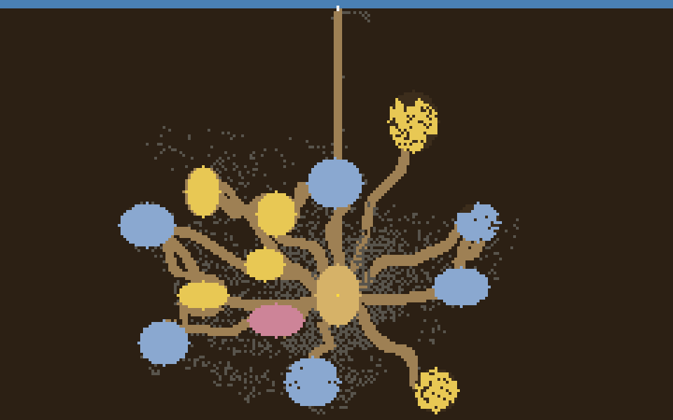

# Myrmecopolis

**蚁国 — 活的、涌现的蚁群生态系统。** 纯 Python，零依赖：
一条命令启动一个可在浏览器中实时观看的蚁群社会——
觅食、掘隧道、育幼，以及从单个房间有机生长成整座地下城市的蚁巢。



*种子 5 运行 15 万 tick 后 —— 14 个房间（主厅 / 育幼室 / 粮室 / 睡室）、
六种曲率形态的蜿蜒走廊、房-房互联捷径，以及一张探索隧道网。*

## 模拟内容

- **完整生命周期** — 卵 → 幼虫 → 蛹 → 成蚁；阶级在羽化时确定；
  衰老、疲劳和饥饿都会致死。
- **觅食与经济** — 食物落在地表，觅食蚁将其搬回，粮室储存，群落过着"即时制"经济生活。
- **自掘蚁巢** — 房间、蜿蜒走廊（六种曲率形态：S 形 / 多波 / 弓形 / 螺旋 / 锯齿 / 微抖）、
  房-房互联捷径和带上限的探索网。布局从不脚本化——全部是挖出来的。
- **涌现控制** — 拥挤度门控繁殖，维护蚁修补坍塌的房间，土壤回收废弃隧道。没有任何脚本化事件。
- **确定性** — 一个种子完全决定群落。

## 快速开始

需要 Python 3.12+（或直接装 [uv](https://docs.astral.sh/uv/)）：

```bash
uv sync
uv run myrmecopolis          # 服务 http://127.0.0.1:8000
```

打开 http://127.0.0.1:8000 —— 群落从一只蚁后加五只工蚁起步，其余全部自建。

无头自检（不起服务器）：

```bash
uv run myrmecopolis --smoke
```

| 参数 | 含义 | 默认值 |
|------|------|--------|
| `--port` | 服务器端口 | `8000` |
| `--seed` | 世界种子（确定性） | `5` |
| `--smoke` | 运行无头自检后退出 | 关 |
| `--ticks` | smoke 测试 tick 数 | `3000` |

## 渲染长时运行蚁巢到 PNG

```bash
uv run tools/render_nest.py   # 15 万 tick → nest_preview.png（当前目录）
```

## 工作原理

240×150 格网格，每帧一次 `World.tick()`（浏览器 60 fps）。
导航是候选格打分——无寻路、无信息素。

- `src/myrmecopolis/constants.py` — 所有可调参数集中一个文件
- `src/myrmecopolis/ant.py`、`colony.py` — 蚂蚁与群落状态机
- `src/myrmecopolis/world.py` — 编排器：地形、食物、挖掘门控、生命周期、序列化
- `src/myrmecopolis/smoke.py` — 无头回归自检
- `src/myrmecopolis/web.py` — 零依赖 HTTP 服务器：SSE 帧流、地形版本管理，以及 `static/` 中的画布渲染器

无第三方库、无构建步骤、无数据文件——只用 `http.server`、`random` 和 `threading`。

## 许可证

MIT — 见 [LICENSE](LICENSE)。
